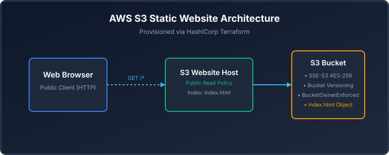
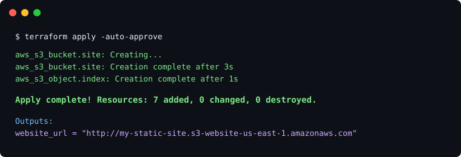

# Deploy a Static Website to AWS S3 with Terraform

A beginner-friendly Terraform project that deploys a public static website to
Amazon S3. It is designed to be cloned, configured, and applied directly to
your own AWS account.

See the [project learning path](LEARNING_PATH.md) for the beginner-to-production
series, including the next network and IAM project.

## Problem this solves

Static websites are often deployed manually, which makes versioning, security
settings, and repeatability easy to miss. This project turns the entire S3
website setup into reviewed, repeatable Terraform code.

## When to use this architecture

Use it for simple public documentation, landing pages, portfolios, or marketing
sites with no server-side rendering. Use CloudFront and a private S3 origin for
production HTTPS, custom domains, and stronger edge security.



## Website preview


## What Terraform creates

- An Amazon S3 bucket
- Bucket-owner-enforced object ownership controls
- Versioning
- Default SSE-S3 encryption (`AES256`)
- Static website hosting with `index.html` as the index document
- A public-access configuration and read-only bucket policy for website files
- The responsive static page in [`website/index.html`](website/index.html)

The public-read policy is intentional for this learning project: direct S3
website endpoints need public read access. S3 website endpoints support HTTP,
not HTTPS. For a production site, use CloudFront with HTTPS and keep the S3
bucket private.

## Prerequisites

- Terraform 1.6+
- An AWS account
- AWS CLI authenticated with AWS IAM Identity Center (SSO), a profile, or
  temporary credentials
- An IAM identity allowed to manage S3 buckets, bucket policies, and public
  access settings

Terraform uses the same credential chain as the AWS CLI. Do not put AWS keys
in Terraform files. See HashiCorp's [provider authentication guidance](https://developer.hashicorp.com/terraform/tutorials/configuration-language/configure-providers).

## Project structure

```text
.
├── .github/workflows/terraform.yml  # Formatting and validation checks
├── main.tf                          # AWS and S3 resources
├── variables.tf                     # Inputs
├── outputs.tf                       # Bucket and website endpoint outputs
├── versions.tf                      # Terraform and provider versions
├── terraform.tfvars.example         # Safe configuration template
├── website/index.html               # Static website content
└── screenshots/                     # Blog visuals
```

## Deploy it step by step

### 1. Clone the repository

```bash
git clone https://github.com/YOUR_GITHUB_USERNAME/terraform-aws-s3-static-website.git
cd terraform-aws-s3-static-website
```

Replace `YOUR_GITHUB_USERNAME` after creating the repository, or copy the
clone URL shown by GitHub.

### 2. Confirm the AWS account

Before creating anything, check the identity Terraform will use:

```bash
aws sts get-caller-identity
```

Review the returned account ID. If it is not the account you intend to use,
stop and authenticate to the correct AWS profile or SSO session.

### 3. Create your variables file

```bash
cp terraform.tfvars.example terraform.tfvars
```

Edit `terraform.tfvars` and choose a **globally unique** bucket name:

```hcl
aws_region  = "us-east-1"
bucket_name = "your-name-terraform-static-site-2026"
environment = "dev"
```

S3 bucket names are unique across all AWS accounts, not only yours. The
`.gitignore` excludes `terraform.tfvars`, so this personal configuration is not
committed accidentally.

### 4. Initialise and validate Terraform

```bash
terraform init
terraform fmt -check
terraform validate
```

`terraform init` downloads the pinned HashiCorp AWS provider and creates
`.terraform.lock.hcl`. Commit that lock file whenever the provider changes.

### 5. Preview the changes

```bash
terraform plan
```

Read the plan before you apply it. It should show the S3 bucket, versioning,
encryption, ownership controls, website configuration, public-access block,
bucket policy, and `index.html` object.

### 6. Deploy to AWS

```bash
terraform apply
```

Enter `yes` when Terraform requests confirmation.



### 7. Open the website

Terraform prints the public website endpoint after a successful deployment:

```bash
terraform output -raw website_url
```

Open that URL in a browser. It has this form:

```text
http://your-bucket-name.s3-website-us-east-1.amazonaws.com
```

## Verify the deployment in the AWS Console

Open the [Amazon S3 Console](https://console.aws.amazon.com/s3/) in the same
AWS account and Region used by Terraform. Select your bucket, then verify:

| Check | Console path | Expected result |
| --- | --- | --- |
| Uploaded page | **Objects** | `index.html` is present |
| Version history | **Properties → Bucket Versioning** | Enabled |
| Encryption | **Properties → Default encryption** | SSE-S3 / Amazon S3 managed keys |
| Website host | **Properties → Static website hosting** | Enabled, index document is `index.html` |
| Ownership | **Permissions → Object Ownership** | Bucket owner enforced |
| Public read | **Permissions → Bucket policy** | Read-only `s3:GetObject` policy for all objects |

Take screenshots of these five Console areas for your blog post. AWS documents
the website-hosting console workflow in its [S3 website hosting guide](https://docs.aws.amazon.com/AmazonS3/latest/userguide/EnableWebsiteHosting.html).

## Important security and cost notes

- The bucket policy exposes only `s3:GetObject` on website files. It does not
  allow public uploads, deletes, or listing the bucket.
- The website is intentionally public and HTTP-only. Do not use this pattern
  for sensitive content or production traffic.
- S3 itself is low-cost, but AWS usage may incur charges. Review the AWS
  pricing page and clean up resources when finished.
- Make sure you can run `terraform destroy` from the same folder. Terraform
  state records what it created.

For a public production site, add CloudFront, an ACM certificate, and a custom
domain as a later project. AWS recommends CloudFront for HTTPS-enabled static
sites; see its [S3 static website tutorial](https://docs.aws.amazon.com/AmazonS3/latest/userguide/HostingWebsiteOnS3Setup.html).

## Clean up

Delete the website and bucket when you finish:

```bash
terraform destroy
```

Confirm the correct AWS account and region before entering `yes`. This removes
the bucket and its website object managed by this project.

## License

MIT
